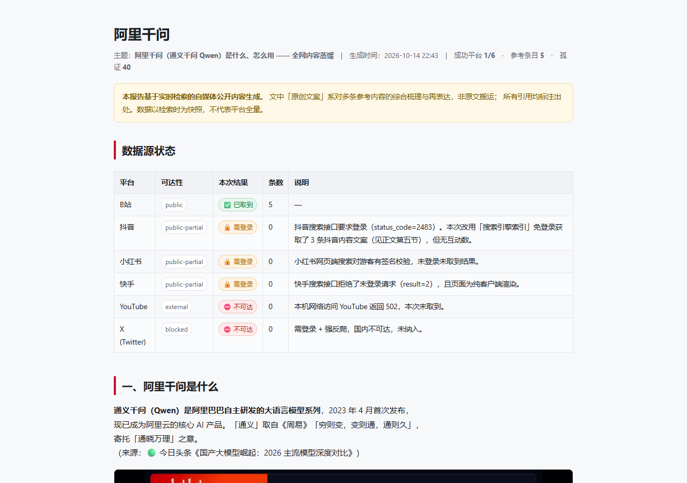

# topic-scout · 全网选题侦察与内容蒸馏

> 输入**一个主题**，自动在 **B站 / 抖音 / 小红书 / 快手 / YouTube / X** 检索相关内容，
> 按**互动量加权热度**每平台取前 5 名 → 蒸馏成**图文并茂的原创内容** →
> 所有引用**与互联网交叉验证**（防幻觉）→ 文末标注**参考来源与金句出处** →
> 最后**主动询问是否要做成小视频**。

一个给 AI Agent 用的 **Skill（技能包）**，遵循 Agent Skills 标准：
`SKILL.md` + YAML frontmatter + 渐进式披露（`references/` 按需加载）+ 可执行 `scripts/`。

---

## 目录

- [为什么做这个](#为什么做这个)
- [它到底能做什么](#它到底能做什么)
- [五条铁律](#五条铁律)
- [快速开始](#快速开始)
- [工作流（八步）](#工作流八步)
- [平台实测可达性](#平台实测可达性2026-10-14-实测)
- [免登录怎么拿内容](#免登录怎么拿内容)
- [复用浏览器登录态](#复用浏览器登录态)
- [多信息源兜底](#多信息源兜底)
- [热度打分口径](#热度打分口径)
- [防幻觉机制](#防幻觉机制)
- [交付物长什么样](#交付物长什么样)
- [实战案例](#实战案例)
- [目录结构](#目录结构)
- [常见问题](#常见问题)
- [局限与维护](#局限与维护)
- [许可与免责](#许可与免责)

---

## 为什么做这个

做内容调研时，真实的痛点是这三件：

1. **平台门禁**：抖音 / 小红书 / 快手现在都要求登录态才能搜索，YouTube / X 在国内直连不可达。
   大部分"全网采集"脚本在这件事上说谎——要么静默返回空，要么用别的平台数据凑数。
2. **AI 幻觉**：抓到标题就敢写"该视频指出……"，数字、专名、时间线全是编的。
3. **图文脱节**：报告是一整面字，教程类内容没有流程、没有配图、没有来源可查。

`topic-scout` 的做法是：**拿不到就如实说，拿到了就必须可溯源**。
它不破解任何平台签名，也不绕过风控；平台不给，就走**多信息源兜底**，
并且把"平台条目"和"第三方网页来源"**分层标注**，绝不混为一谈。

---

## 它到底能做什么

| 能力 | 说明 |
| --- | --- |
| 六平台按主题检索 | B站 / 抖音 / 小红书 / 快手 / YouTube / X，默认全开 |
| 互动量加权热度 TopN | 不是只按播放量排，见[热度打分口径](#热度打分口径) |
| 数据源状态如实披露 | 每个平台成功/失败、失败**原因**都写进 `source_status.json` |
| 免登录热榜抓取 | 抖音 / 微博 / B站 / 百度热榜，**零登录** |
| 免登录内容通路 | 热榜 + 搜索引擎索引 + 抖音公开页，见[免登录怎么拿内容](#免登录怎么拿内容) |
| 登录态复用 | 导出本机浏览器 cookie 注入，或持久化 profile 扫码一次长期复用 |
| 多信息源兜底 | 平台被门禁挡住时转联网检索补源，并分层标注 |
| 内容蒸馏 | 生成 `references / outline / quotes / draft` 四件套 |
| 金句溯源 | 每条金句必须指到「平台 + 作者 + 链接」 |
| 交叉验证 | 一致性分级、孤证标记、指标异常检测、时间线校验 |
| 视频截帧配图 | yt-dlp 下载 + ffmpeg 抽帧 + contact sheet |
| 单文件图文报告 | HTML（图片 base64 内嵌）+ Markdown 双份 |

---

## 五条铁律

| # | 铁律 |
| --- | --- |
| 1 | **拿不到就如实说，绝不编造**（平台不可用、只有标题、指标缺失都要如实标注） |
| 2 | **原创 ≠ 洗稿**，引用必须标出处；金句必须是原文 |
| 3 | **必须与互联网交叉验证**，孤证必须标「仅单一来源」，数字专名必须核 |
| 4 | **图文并茂是硬要求**，每张图必须有图注 + 来源链接 |
| 5 | **最后主动问「要不要做成小视频」**，不自动做 |

---

## 快速开始

### 环境

```bash
PY="C:/Users/Administrator/.workbuddy/binaries/python/envs/default/Scripts/python.exe"
```

依赖：`playwright`、`Pillow`、`imageio-ffmpeg`、`yt-dlp`
（复用浏览器登录还需 `pywin32`、`cryptography`）。

浏览器用 **Playwright 自带 chromium**（脚本自动探测）。
> ⚠️ 不要用夸克内核浏览器，会在数秒后自关（`page closed`）。

### 三条最常用命令

```bash
# ① 先看平台可达性（秒回，必做）
python scripts/collect_topics.py --check-platforms

# ② 采集（默认六平台全开、每平台 Top5、免登录）
python scripts/collect_topics.py --topic "在家做面包" --top 5 --out ./out/bread

# ③ 免登录抓各平台热榜
python scripts/fetch_hotlist.py --top 20 --out ./out/hot
```

### 安装为 Skill

把整个目录拷到技能目录即可：

```bash
# WorkBuddy
cp -r topic-scout ~/.workbuddy/skills/
# Claude Code / Codex
cp -r topic-scout ~/.claude/skills/     # 或 ~/.codex/skills/
```

或者直接解压发布包 `topic-scout-v1.0.0.zip`。

---

## 工作流（八步）

```
步骤 0  确认输入        主题 / 平台 / 每平台几名（缺失才问）
步骤 1  看平台可达性    collect_topics.py --check-platforms
步骤 2  采集            collect_topics.py --topic "…" --top 5 --out ./out/x
步骤 2.5 多源兜底       平台被门禁挡住时：联网补源 / 扫码登录 / 换关键词
步骤 3  蒸馏 + 溯源     distill.py      → references / outline / quotes / draft
步骤 4  交叉验证        verify_cross.py → 置信度分级 / 孤证 / todo_verify
                        ⭐ 再用 WebSearch 真的去核 todo_verify
步骤 5  配图            grab_frames.py  → 视频截帧 + contact sheet
步骤 6  写正文          在 out/body.md 写原创文案（含来源标注、插图）
步骤 7  生成报告        make_report.py  → report.html + report.md
步骤 8  总结 + 问视频   讲清覆盖与共识，主动问是否做小视频
```

一句话用法（对 Agent 说）：

```
帮我搜一下「在家做面包」这个主题，各平台高赞内容收集整理，做成图文内容
```

---

## 平台实测可达性（2026-10-14 实测）

| 平台 | 访问方式 | 能得到什么 | 状态 |
| --- | --- | --- | --- |
| **B站** | 免登录 | 标题/作者/播放/点赞/评论/收藏/时长/简介 | ✅ **唯一稳定可用** |
| **抖音** | **需登录**（硬门禁 `status_code=2483`） | 标题/作者/点赞/评论/收藏/转发 | 🔒 未登录直接拒 |
| **小红书** | **需登录**（`x-s` / `x-t` 签名） | 标题/作者/点赞/收藏/评论 | 🔒 游客签名校验 |
| **快手** | **需登录**（内部接口 `result=2`） | 标题/作者/播放/点赞/评论 | 🔒 接口拒未登录 |
| **YouTube** | 需网络可达 + yt-dlp | 标题/作者/播放量 | ⛔ 国内直连不可达 |
| **X** | 需登录 + 强反爬 | —— | ⛔ 默认不纳入 |

> ⚠️ **重要现实**：**B站是唯一免登录能稳定取到数据的平台**。
> 抖音 / 小红书 / 快手都已要求登录态——**这是平台规则，不是脚本缺陷，不要硬刚**。
> 脚本已能**快速判定**登录门禁（5~9 秒，不再空等）并如实上报原因。

**默认全平台全开**，能拿到几个算几个，其余在「数据源状态」如实标注。

---

## 免登录怎么拿内容

「抓不到」**不等于**「任务结束」。免登录有三条通路：

### ① 热榜（已自动化，零登录）

```bash
python scripts/fetch_hotlist.py --top 20 --out ./out/hot
```

| 来源 | 接口 | 状态 |
| --- | --- | --- |
| 抖音 | `/aweme/v1/web/hot/search/list/` | ✅ 50 条，含 `hot_value` |
| 微博 | `weibo.com/ajax/side/hotSearch` | ✅ 含 `num` |
| B站 | `x/web-interface/ranking/v2` | ✅ 含播放量、UP 主 |
| 百度 | `top.baidu.com/api/board` | ✅ 含 `hotScore` |
| 知乎 | —— | ✗ 不可用 |
| 快手 | GraphQL + 签名 | ✗ 不可用 |

> 🔑 **关键坑**：每个域名的 API 必须**先从该域名自己的页面发起**再抓，否则被 CORS 拦。
> `fetch_hotlist.py` 内部已处理（先 `goto(home)`，再 `fetch`）。

### ② 搜索引擎索引（拿内容的主力）

用 `WebSearch` 搜 `site:douyin.com <关键词>`——**搜索引擎索引常含视频完整文案**。

实测：搜「阿里千问」，直接拿到了抖音上"豆包 vs 千问"对比视频的**逐字文案**。

### ③ 抖音公开页

- `/hot` 榜单页（约 803 KB）
- `/shipin/<id>` 视频页（约 953 KB，含 100+ 句中文文案）

> ⚠️ 但 `/video/<id>` 的 `RENDER_DATA` **只有 app 配置，没有统计数据**；
> `/hashtag/<id>` 有 801 KB 却 **0 个视频 id**（话题页同样要登录）。

**一句话记住**：**登录是为了「搜索」；不登录也能用「热榜 + 搜索引擎索引」拿内容线索。**

---

## 复用浏览器登录态

两条路，都需要用户**自己的**登录态（脚本不代登录、不破解）：

```bash
# 路 A：持久化 profile，扫码一次，长期复用
python scripts/collect_topics.py --topic "…" --profile ./profile --headful

# 路 B：从本机浏览器导出 cookie 注入
python scripts/import_login.py --browser chrome --domain douyin.com
python scripts/collect_topics.py --topic "…" --cookies ./cookies/douyin.json
```

技术细节：`import_login.py` 读 Chrome `Local State` 里的 `os_crypt.encrypted_key`
→ DPAPI 解密 → AES-256-GCM 解 `v10` / `v11` 的 `encrypted_value`。

> ⚠️ **已知限制**：Chrome **运行时** `Cookies` 库被独占锁定（WinError 32），读不了。
> 需**完全退出浏览器**（含后台进程）后再导出，或直接走 `--profile`。

---

## 多信息源兜底

当目标平台被登录门禁挡住时，**不要就此收工**，走阶梯：

```
① 如实告知 + 让用户三选一（联网补源 / 扫码登录 / 只要 B站）
② 联网检索补源  ← 推荐：官方文档 / 权威媒体 / 中文整理 / 争议反证
③ 用户扫码登录（--headful）
④ 换关键词叫法重试
```

**分层标注铁律**：兜底拿到的网页资料**必须单独成表**（带 URL + 可信度），
写「据 <来源> 记载」，**绝不能**写成「某平台有人说」。

---

## 热度打分口径

不只看播放量——播放量容易刷，互动更能反映内容质量：

```python
HOT_WEIGHTS = {
    "likes":    1.0,    # 点赞
    "comments": 1.6,    # 评论（成本最高，权重高）
    "collects": 1.4,    # 收藏（"有用"信号）
    "shares":   2.0,    # 转发（最强推荐信号）
    "views":    0.02,   # 播放（量纲大，压权重）
}

hot = likes×1.0 + comments×1.6 + collects×1.4 + shares×2.0 + views×0.02
```

例：一个 10 万播放、5000 赞、800 评论的视频
`hot = 5000 + 1280 + 0 + 0 + 2000 = 8280`；
一个 50 万播放、2000 赞、50 评论的
`hot = 2000 + 80 + 0 + 0 + 10000 = 12080`。
—— 播放量高 5 倍，但热度分只高 1.46 倍，这就是"互动加权"的意义。

字段缺失时按 `0` 计，并在 `source_status` 标注，不猜、不补。

---

## 防幻觉机制

### 内容可信度分级（`content_source`）

| 级别 | 含义 | 能否写进内容摘要 |
| --- | --- | --- |
| `transcript`（4） | 完整口播转写 | ✅ 可 |
| `subtitle`（3） | 字幕 | ✅ 可 |
| `desc`（2） | 视频简介 | ⚠️ 只能做主题标注 |
| `title-only`（1） | 只有标题 | ❌ 不可，只能说明"有这个选题" |

### 交叉验证（`verify_cross.py`）

- **一致性分级**：≥3 个独立来源一致 = 高；2 个 = 中；1 个 = **孤证，必须标注**
- **指标异常检测**：`likes > views`、`comments > likes`、缺失 URL 等
- **时间线校验**：无日期 / 未来日期 / 过期内容告警
- **`todo_verify` 清单**：列出所有必须**真的用 WebSearch 去核**的条目

### 分层标注

- 🔵 平台条目（B站 / 抖音 / …）
- 🟢 官方来源
- 🟡 媒体来源
- ⚪ 百科 / 聚合

平台条目与第三方网页来源**分表呈现**，口径见 `references/multi-source-fallback.md`。

---

## 交付物长什么样

每个主题一个目录：

```
out/<topic>/
├── collected.json      六平台原始条目（含热度分）
├── collected_all.json  采集全量
├── source_status.json  各平台成功/失败 + 原因
├── references.json     蒸馏后的参考条目（含 content_source 分级）
├── outline.json        教程类流程骨架
├── quotes.json         金句 + 出处（平台/作者/链接）
├── draft.md            文案骨架
├── verification.json   交叉验证结果 + todo_verify
├── body.md             ⭐ 原创正文（图文，含来源标注）
├── report.md           Markdown 报告
├── report.html         ⭐ 单文件 HTML（图片 base64 内嵌，可直接分享）
└── frames/             视频截帧 + contact sheet
```

报告截图（阿里千问主题，实际产出 294 KB / 3 张配图 / 11 张表格）：



---

## 实战案例

### 案例 A：主题「skill 介绍」

- B站 ✅ 取到 5 条（含《从 LLM 到 Agent Skill》《8 个 Skills 平台 3 种安装方法》）
- 抖音 🔒 搜索门禁 → 走多源兜底，用搜索引擎索引补到抖音内容
- 交叉验证命中 Anthropic 官方、agentskills.io、Microsoft Learn 等权威源
- 产出：`report.html` 504 KB / 5 张配图 / 13 张表格

### 案例 B：主题「阿里千问」（防幻觉的教科书案例）

第三方站点普遍写「Qwen3.7-Max（5 月发布）」——**这是过时的**。
交叉验证后，官方源给出的事实是：

| 项 | 官方核实结果 |
| --- | --- |
| 版本 | **Qwen3.8-Max** |
| 发布时间 | **2026-08-03** |
| 参数 | **2.4 万亿**，激活约 **950 亿** |
| 上下文 | **100 万 Token** |
| 排名 | LMArena 文本第 5 / 视觉第 2，CodeArena 第 4 |
| 定价 | ¥12 / 百万输入，¥36 / 百万输出 |

4 个官方来源一致 → 判为**高置信**；第三方口径在报告中明确标注为**存疑/已过时**。

---

## 目录结构

```
topic-scout/
├── SKILL.md                 主文档（五条铁律 + 八步工作流 + 输出契约）
├── README.md                本文件
├── manifest.json            技能元数据与能力声明
├── agents/interface.yaml    输入输出契约
├── evals/trigger_cases.json 触发 / 不触发用例
├── references/
│   ├── platforms.md             六平台实测可达性、字段、坑、维护指引
│   ├── no-login-sourcing.md     不登录时如何拿到平台内容（8 节）
│   ├── multi-source-fallback.md 多源兜底阶梯与分层标注
│   ├── hot-ranking.md           热度分权重口径与 Top5 截取规则
│   ├── distill-and-cite.md      禁幻觉红线、原创边界、金句溯源规范
│   └── verification.md          置信度分级、四路核校法、话术规范
├── scripts/
│   ├── platforms.py         平台规格 / 数据契约 / 热度打分 / 浏览器封装
│   ├── searchers.py         六平台检索实现
│   ├── collect_topics.py    采集主入口（--profile / --cookies）
│   ├── import_login.py      从本机浏览器导出 cookie 复用登录态
│   ├── fetch_hotlist.py     免登录抓各平台热榜（抖音/微博/B站/百度）
│   ├── distill.py           榜单聚合 + 文案骨架 + 金句溯源
│   ├── verify_cross.py      交叉验证 + 存疑清单
│   ├── grab_frames.py       视频截帧配图
│   ├── make_report.py       图文并茂单文件报告生成
│   └── ytdlp_util.py        yt-dlp 路径解析
└── examples/                示例产物
```

---

## 常见问题

**Q：真能免登录上抖音快手吗？**
A：**热榜可以**（抖音 ✅），**搜索不行**。抖音搜索接口返回 `status_code=2483`；
快手内部接口返回 `result=2`。但搜索引擎索引能拿到抖音视频的**完整文案**，实测可行。

**Q：为什么不直接破解签名？**
A：这是明确的红线。技能 `core_constraints` 里写了「绝不尝试破解平台签名/绕过风控」。
能拿多少拿多少，拿不到就走多源兜底——**诚实比数据全更重要**。

**Q：Chrome 明明登录了，为什么导出 cookie 失败？**
A：Chrome 运行时 `Cookies` 库被独占锁定（WinError 32）。**完全退出浏览器**再导出，
或改用 `--profile ./profile --headful` 扫码一次、之后长期复用。

**Q：跨平台热榜一开始全失败？**
A：CORS。每个域名的 API 必须**先从该域名自己的页面发起**。`fetch_hotlist.py` 已处理。

**Q：B站偶尔返回空？**
A：多为瞬时限流或风控，重试即可；不是 bug。报告里会如实标为 `empty`。

**Q：和 `creator-content-digest` 有什么区别？**
A：本技能按**主题**跨平台检索；那个是按**某个博主**整理全部作品。

---

## 局限与维护

坦白讲清楚边界，避免误用：

1. **B站是唯一的免登录主通道**，其余平台要么需登录、要么不可达。
2. 平台页面结构与接口**随时会变**（快手页面为纯 CSR，`__USE_SSR__` 无数据）。
   → 建议每月跑一次 `--check-platforms` 复核。
3. **不破解签名、不绕过风控**；能力边界变化时会如实更新 `references/platforms.md`。
4. 视频截帧依赖 yt-dlp + ffmpeg 与网络可达性；国内 YouTube 通常不可达。
5. 冷启动单平台约 5~20 秒；**不要**一次并发六平台（实测 600 秒会超时）。

---

## 许可与免责

- 代码：**MIT**
- 本技能**不提供、不代持任何平台登录凭据**，登录态完全来自用户本机浏览器。
- 所有抓取值仅供**个人调研与学习**；引用他人内容请标注出处并遵守各平台服务条款与著作权法。
- 生成内容为蒸馏后的原创表述，不构成事实断言；关键数字请以官方来源为准。

---

<sub>实测环境：Windows 11 · Python 3.13 · Playwright bundled chromium · 2026-10</sub>
